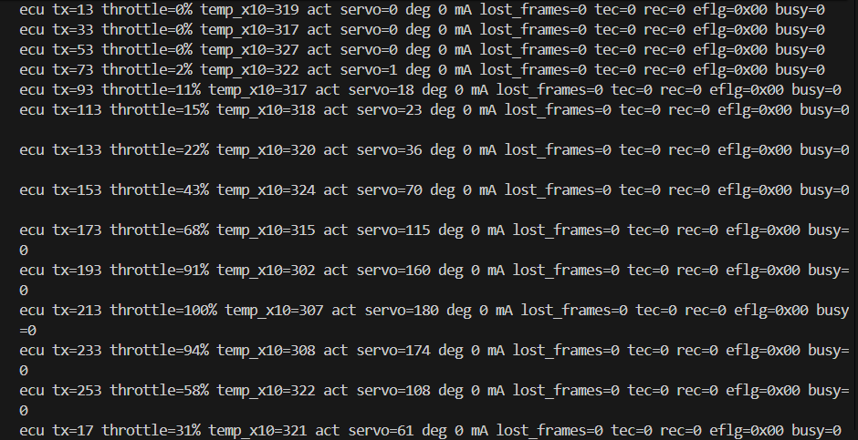
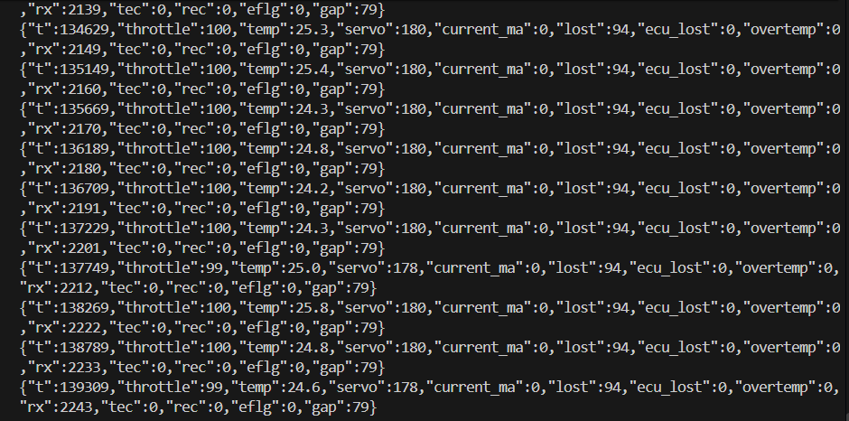
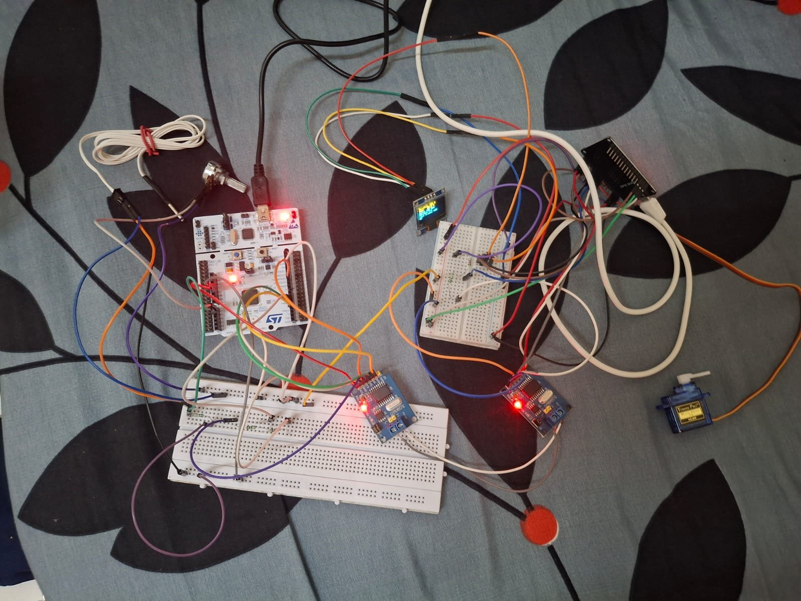
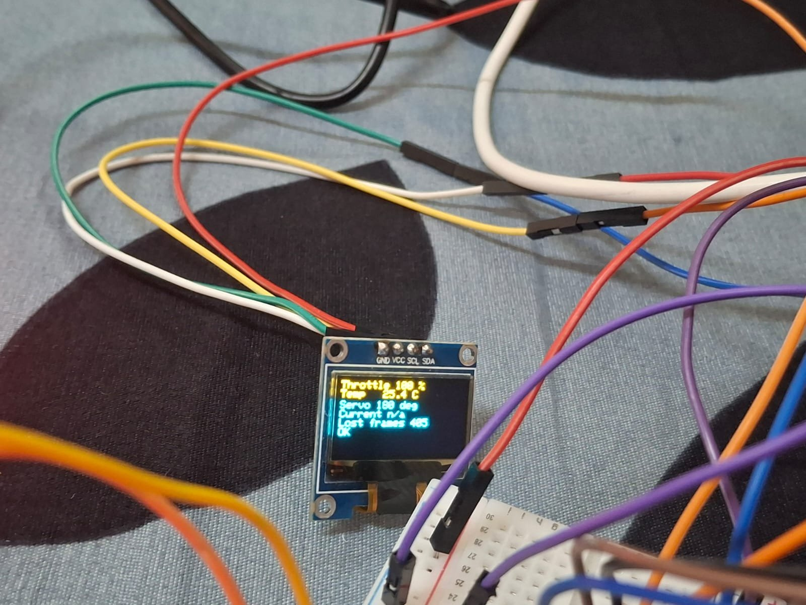

# CAN ECU demo: STM32 + ESP32 over a real CAN bus

A small "mini vehicle network" with two nodes that talk over CAN (500 kbit/s):

- **STM32 Nucleo-F411RE = powertrain ECU.** Reads a pot (throttle) and an NTC (temperature) and sends them every 50 ms.
- **ESP32 = actuator and gateway.** Moves a servo to follow the throttle, measures the servo current (INA219), sends its status back, shows everything on an OLED, and prints a JSON line for a dashboard.
- **Fault handling:** CAN timeout, lost-frame counter, over-temperature cut-off, bad-frame rejection. All the logic is plain C in `common/` and is unit tested on a PC with GitHub Actions.
- Each node uses an MCP2515 CAN controller module over SPI, driven by my own driver (`common/mcp2515.c`).

```
 pot, NTC --> STM32 --SPI--> MCP2515 ==CANH/CANL== MCP2515 <--SPI-- ESP32 --> servo, INA219, OLED, USB JSON
```

## Folders

| Folder | What |
| --- | --- |
| `common/` | Portable C: message format, NTC maths, MCP2515 driver. Same files on both boards and on the PC |
| `tests/` | Unit tests (`make test`), including a software model of the MCP2515 chip |
| `stm32_pio/` | STM32 ECU as a PlatformIO project for VS Code (pins and peripherals set up in code, no CubeMX). Contains copies of the `common/` files |
| `esp32/` | PlatformIO project for the gateway |
| `docs/` | `wiring.md` and `protocol.md` |

## Run the tests (no hardware needed)

```
make test
```

## STM32 in VS Code (PlatformIO) - the easy way

1. Install the **PlatformIO IDE** extension in VS Code and restart it.
2. Open the `stm32_pio` folder in VS Code (File > Open Folder).
3. Plug in the Nucleo by USB. Click the tick (Build) at the bottom bar, then the arrow (Upload).
4. Open the Serial Monitor (plug icon). Expect `MCP2515 init OK`.

The `stm32_pio/src` and `include` folders hold copies of `common/`; `common/` is the master copy.

If your NTC is 10k (marked 103), delete the `-DNTC_R_NOMINAL=100000.0f` line in `stm32_pio/platformio.ini`. If you have two boards plugged in, add `monitor_port = COMx` (the right port) to each `platformio.ini` so the monitor opens the correct one.

## ESP32

Open the `esp32` folder in VS Code and use the Build and Upload buttons (hold BOOT if the upload waits at "Connecting"), or from a terminal:

```
cd esp32
pio run -t upload
pio device monitor
```

## Reading the CAN error counters

The STM32 log line ends with `tec`, `rec`, `eflg`, and the ESP32 JSON has the same. On a healthy bus all three stay at 0. `tec=128` with nobody answering means the node is alone on the bus; `tec` that climbs to 248 and restarts means the node sees a different signal than it sent (bad wiring or contact).

## Results

Measured on the bench (STM32 Nucleo-F411RE + ESP32 DevKit, MCP2515 modules with 8 MHz crystals, 500 kbit/s).

| Check | Result |
|-------|--------|
| CAN link | ESP32 receives about 20 ECU frames per second; both nodes report `tec=0 rec=0` while linked |
| Throttle to servo | Pot 0 to 100 % moves the servo 0 to 180 degrees, following the pot smoothly |
| Temperature (NTC 100k, beta 3950) | Reads room temperature; steady within about 1 degree C while the pot is turned from 0 to 100 % |
| CAN fault (one bus wire unplugged) | ESP32 flags `ecu_lost`, servo goes to 0 degrees, OLED shows `ECU SILENT`; recovers by itself when the wire is back |
| Over-temperature (NTC heated above 60 degrees C) | ESP32 flags `overtemp`, servo goes to 0 degrees, OLED shows `OVER-TEMP` |
| Loop timing | ESP32 main loop pauses stay under about 110 ms (reported as `gap` in the JSON log) |

Not tested: servo current measurement (INA219). The code supports it and the OLED shows `Current n/a` when it is not fitted.

STM32 serial log while the pot is turned from 0 to 100 % and back (the `0 mA` field is the servo current reported by the ESP32; it stays 0 because the INA219 is not fitted):



ESP32 serial log (JSON line every 500 ms): throttle 100 %, servo at 180 degrees, `rx` counting up, `tec` and `rec` at 0, no ECU loss:



The bench setup: STM32 Nucleo with pot and NTC on the left, ESP32 with OLED and servo on the right, a CAN module on each side:



OLED on the ESP32 during normal operation (throttle, temperature, servo angle, current not available, lost frames, status OK):



Short demo video of the bench setup being operated: [docs/demo/can_ecu_demo.mp4](docs/demo/can_ecu_demo.mp4)

Fault conditions are detected by the sensors and the CAN link: a lost CAN link shows `ECU SILENT` and an over-temperature reading shows `OVER-TEMP` on the OLED, and in both cases the servo goes to its safe position (0 degrees).
